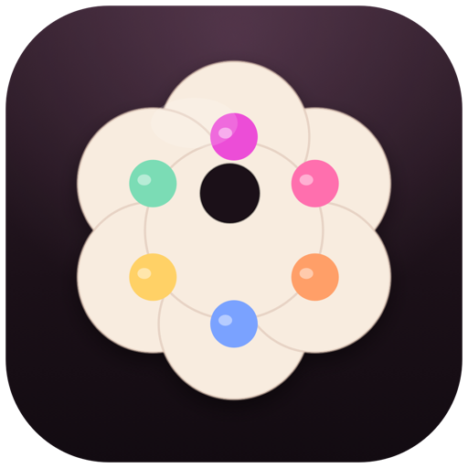

# Palette

<p align="center"></p>

A keyboard-first launcher for macOS, built as a native app with a deliberately
extensible provider system. Press a hotkey, type, act. No window chrome, no
Dock icon, no script layer holding the core together.

```
⌥Space → /neo dotfiles → ⏎ opens the folder in Neovide
```

## Status

v2.0.4. Built for macOS 14+ (developed on macOS 27), Apple silicon. Not sandboxed
and not distributed through the App Store, by design: a launcher needs to see
your files and drive other apps.

## Requirements

| Tool | Why | Install |
|---|---|---|
| `fd` | filesystem enumeration for `/neo` and `/neof` | `brew install fd` |
| `fzf` | ranking for path results | `brew install fzf` |
| `zellij` | `/zj` sessions | `brew install zellij` |
| `kitty` | terminal used by `/zj` | `brew install --cask kitty` |
| `bw` | Bitwarden provider | `brew install bitwarden-cli` |

Only `fd` and `fzf` are needed for the core file workflows. Missing tools are
surfaced as an install row inside the launcher; nothing is installed silently.

## Build and install

```sh
make            # build a release app bundle at build/Palette.app
make install    # copy it to ~/Applications
make run        # build and launch the bundle in build/
make test       # run the test suite
```

The app is ad-hoc signed. macOS may ask for Accessibility permission again
after a rebuild; that is expected without a Developer ID certificate.

### Homebrew

Palette ships through a public tap:

```sh
brew install --cask Myleshen/tap/palette
```

The cask downloads the latest GitHub release, installs `Palette.app` into
`/Applications`, and clears the quarantine flag because the app is ad-hoc signed
rather than notarized. No Apple Developer subscription or App Store listing is
involved. Manual zip downloads may need System Settings > Privacy & Security >
Open Anyway.

To publish a new version: bump `CFBundleShortVersionString` and
`CFBundleVersion`, run `make release`, upload `dist/Palette-<version>.zip` to a
GitHub release, then copy `packaging/homebrew/Casks/palette.rb` into
`Myleshen/homebrew-tap/Casks/`. See `packaging/homebrew/README.md`.

## First run

1. Launch Palette. It lives in the menu bar.
2. Press `⌥Space`.
3. Run a command that pastes (for example a clipboard entry and `⌘⏎`) and grant
   Accessibility when prompted. Copy-only actions work without it.

Configuration lives in `~/.config/palette`:

```
~/.config/palette/
  config.toml
  providers/
    neof/provider.toml      # user copy of the file provider, seeded for you
  themes/                   # optional user themes
```

The bundled `/neo` provider lives inside the app. On first run Palette writes a
commented `config.toml` and seeds `providers/neof` so both examples are ready to
use without copying anything.

State (history, clipboard, frecency) lives in `~/.local/state/palette`.
Caches live in `~/Library/Caches/Palette`.

## Using it

| Key | Action |
|---|---|
| `⌥Space` | show / hide |
| `⌥V` | clipboard browser with live preview |
| `↑` `↓` | move selection |
| `⏎` | primary action |
| `⌘⏎` | secondary action (usually paste, or reveal for paths) |
| `⌘K` | action list for the selection |
| `⌘1`…`⌘9` | open the nth result |
| `Tab` / `⇧Tab` | cycle provider tabs (`/web`, `/zj`, `/bw`, …) |
| `Esc` | clear the query, then dismiss |
| `⌘,` | open Settings |
| `⌘R` | reload config, themes, and providers after manual file edits |

Application rows expose Open, Show in Finder, Copy Bundle ID, and Copy Path in
`⌘K`; files and folders expose their own open/reveal/copy actions.

### Provider tabs

A tab strip under the search field shows Apps plus every provider that declares
a trigger. It starts on **Apps**; clicking a tab opens that provider with an
empty query. `Tab` and `⇧Tab` cycle through them without reaching for the
mouse, so `/web`, `/zj`, `/bw`, `/clip`, and the rest are one key away.

### Prefixes

A prefix routes the query to one provider. The shared prefix character is
configurable (`provider_prefix`, default `/`), and each provider declares a bare
trigger word:

| Prefix | Provider |
|---|---|
| `/neo <query>` | files and folders, opened in Neovide |
| `/neof <query>` | folders only, opened in Neovide |
| `/zj <query>` | zellij sessions; `⏎` attaches or creates in kitty |
| `/bw <query>` | Bitwarden passwords |
| `/bwu <query>` | Bitwarden usernames |
| `/bwt <query>` | Bitwarden TOTP codes |
| `/bwn <query>` | Bitwarden notes |
| `/bwo <query>` | Bitwarden URLs |
| `/clip <query>` | clipboard history, text/images/files |
| `/port <query>` | listening TCP ports, with process and PID |
| `/cmd <query>` | commands from `~/.config/palette/commands.toml` |
| `/proj <query>` | devx projects and worktrees, or `~/dev` fallback |
| `/git <query>` | repositories with managed Git actions and panel output |
| `/term` | embedded terminal shell |
| `/scratch` | persistent text scratchpad |
| `/ask <question>` | one-shot OpenCode Go answer |
| `/askh <query>` | search retained Ask questions and answers |
| `/web <query>` | saved web apps; type a domain to add one |
| `/emoji <query>` | emoji picker |
| `/sys <query>` | settings, lock, sleep, trash, reload, quit |
| `/theme <query>` | switch themes live |
| `/calc <expr>` | calculator (also works unprefixed) |

A trailing slash browses a directory breadth-first: `/neo ~/dev/` shows the
direct children of `~/dev` first, then the next level.

Unprefixed queries search apps, web apps, zellij sessions, pinned items, web
search engines, and any provider marked `global = true`. `= 2+2` and bare
arithmetic also work.

### Search matching

Matching is fzf-style, not exact-substring. Type the letters you remember and
Palette scores runs, word boundaries, and gaps: `actmon` finds **Activity
Monitor**, `vsc` finds **Visual Studio Code**, `qbf` finds **The quick brown
fox**, `tst` finds a Bitwarden login named **Test**, and `drgn` finds **Dragon**.
This applies to apps, clipboard text and file names, web apps, providers,
themes, and Bitwarden vault fields. Clipboard search scans the whole configured
history instead of only doing a SQL prefix match, so non-contiguous searches
work there too. `/neo` still delegates path ranking to the real `fzf` binary
with `--scheme=path`.

The empty-query screen is deliberately the **app list**: apps in alphabetical
order (or most-used), with pinned apps and pinned web apps at the top. Unpinned
web apps, running sessions, and search suggestions stay out of that screen until
you type or pick their tab.

### Web search

Type any query that is not a file or app and Palette offers one row per
configured engine (Google, DuckDuckGo, GitHub, YouTube by default). `⏎` opens
the result in your default browser. Engines are ordinary config rows in
`[web_search]`; add or remove them in Settings or `config.toml`.

### Ask

`/ask` sends one quick question to an OpenAI-compatible endpoint and stores the
answer. It is deliberately one-shot: there is no conversation thread, so every
question is independent.

Supported endpoint:

- **OpenCode Go** (`https://opencode.ai/inference/go/openai/v1`) — every
  OpenAI-compatible Go chat model, ordered cheapest output price first. A Go
  key is required.

Type `/ask` with no question to choose a model. Free Go models are listed first
and marked `FREE`; paid models show their input/output price per million tokens
and are ordered cheapest first. `/ask what is 2+2` asks the selected model
directly. Answers can be copied, asked again, or found later in history.

The **Ask History** sub-tab (or `/askh`) searches retained questions and answers.
Each row shows the model, endpoint, age, latency, and token usage. Ask history is
kept up to the count and age configured in Settings and can be deleted per row.

API keys are stored in an encrypted user-only file under Palette's config
directory, not in `config.toml`. A key is visible in the Settings
field only before you save it; afterward Palette shows “Key saved in the macOS
local key file” and never displays the value again. Keys are never written to
`config.toml`, logs, or history. `OPENCODE_API_KEY`, `OPENCODE_GO_API_KEY`, and
`OPENAI_API_KEY` are also accepted as environment fallbacks.

### Settings

`⌘,` (or the menu-bar icon) opens a native Settings window. **General** holds
shortcuts, the terminal/editor used by providers, launcher position, and app
order. **Appearance** holds themes and typography. **Clipboard**, **Search**, and
**Ask** cover their own features. **Providers** controls which tabs are visible,
their order, and optional aliases. **Advanced** has config/theme/log links,
backup, diagnostics, and version information. The **Ask** tab selects the endpoint and model,
saves a local API key, toggles automatic fallback, and controls how many Q&A
entries and how many days of history are kept.
Hotkeys are recorded by pressing them, not typed. The recorder uses a short-lived
session event tap, so macOS-reserved combinations such as `⌘Space` are captured
instead of being swallowed by the system; it stops as soon as Settings loses
focus. Accessibility permission is needed for reserved-key capture. Saving
validates both shortcuts and refuses a browser that is not installed. Changes
apply immediately. Editing files by hand still works, then press `⌘R`.

### Search position

`search_position = "top" | "center"` controls where the panel opens. `center`
keeps the top-first layout but opens the panel in the middle of the screen.
The older `bottom` value is accepted for compatibility and now maps to
`center`.

The launcher is always the two-surface pill: a floating search capsule above a
rounded content card. There is no alternate classic layout.

### Pinned items

`⌘K` on any result includes **Pin to Palette**; every pinned row also offers
**Unpin from Palette**. Pinned apps and pinned web apps rise to the top of the
default app screen and global search. Pins are stored in Palette’s SQLite state.

### Clipboard

`⌥V` opens a wide clipboard browser with a live preview pane; `/clip` opens the
same history in the normal window. Copied text, images, and Finder file
selections are stored separately and listed under **Text**, **Images**, and
**Files** headings. Add a category word to filter: `/clip text`,
`/clip images`, `/clip files`, optionally followed by a search.

- `⏎` on any clipboard row **pastes immediately** into the app you came from,
  after which the clipboard browser closes. With Accessibility granted this is
  a real ⌘V; otherwise Palette copies the entry and opens the permission prompt.
- Text rows preview in full; long entries can be copied in full or pasted.
- Images store a thumbnail and dimensions, with Copy/Paste Image.
- Files keep their paths, icon, size, and a `bat` render for text files, with
  Copy/Paste Files and Reveal in Finder.

Pinned entries sort to the very top, across every category, and the filter tabs
above the list switch between **All**, **Text**, **Images**, and **Files**.
`⌘K` toggles **Pin** and **Delete** for every kind. Retention defaults to 5,000
entries and is configurable in Settings; images are stored as PNG and files as
paths in Palette’s SQLite state. Anything marked concealed by another app is
never recorded.

Values copied from Bitwarden are always written as concealed and clear after 30
seconds, so they never enter Palette’s clipboard history.

The vault listing and the CLI session key are sealed with AES-GCM under
`~/Library/Caches/Palette/Bitwarden` for thirty days, scoped to the active CLI
profile. Restarting Palette inside that window does not ask for the master
password again; **Refresh Bitwarden Cache** forces a fresh read without logging
you out. The master password itself is never stored.

### Bitwarden

`/bw`, `/bwu`, `/bwt`, `/bwn`, and `/bwo` share one in-memory session. The first
read of a vault is cached for **thirty days** in an AES-GCM encrypted file under
`~/Library/Caches/Palette/Bitwarden`; the key is a per-user `0600` file. Prefix
switches, typing, and copy actions reuse the snapshot instead of spawning
`bw list` again. Choose **Refresh Bitwarden Cache** in the menu-bar menu when the
vault changed elsewhere; the next search reads it fresh. The cache is scoped to
`BITWARDENCLI_APPDATA_DIR`, so test and real profiles never mix.

### Web apps

`/web` keeps your own web-app shortcuts, independent of any browser-specific
“install as app” feature. An **Add Web App…** row is always present; choose it
(and paste a URL), or type a domain directly:

1. `/web figma.com`
2. choose **Add Web App “Figma”**
3. give it a name, then optionally a shortcut such as `ctrl+alt+f`

Local development URLs work too: `/web http://localhost:5173` or
`/web http://127.0.0.1:8080`.

Web apps open in Helium by default, in their own Chromium **app window**
(`--app=…`) with a dedicated Palette profile, not as a normal browser tab.
Change the browser in Settings → Search; only Chromium-based browsers are
listed and Palette will not save one that is not installed. Hammerspoon
shortcuts use the same app-window launcher, so the shortcut opens the same
standalone window instead of Safari.

A shortcut needs at least two modifiers. Palette writes
`~/.hammerspoon/palette-webapps.lua`; Hammerspoon watches that file and binds
each app to its URL, so shortcuts are managed here, not by editing Hammerspoon
config. Use `⌘K` on a saved app to open it, copy its URL, set/change or clear
its shortcut, or remove it. Opens are counted by the normal frecency store, so
frequently used apps rise to the top. Definitions live in Palette’s SQLite
state, not in `config.toml`.

### Clipboard transforms

`⌘K` on any text entry includes **Transform Text…**. Pick a transform and the
result opens with a full preview; `⏎` copies it and `⌘⏎` pastes it. Built-ins:
trim, JSON pretty/minify, YAML format, TOML format, Base64 encode/decode, URL
encode/decode, shell quote, path quote, uppercase/lowercase, sort/dedupe lines,
strip ANSI, Markdown link, and slug. Transforms are local and deterministic; no user script runs from a
clipboard copy.

### Scratchpad and terminal

`/scratch` opens a persistent editor inside the panel. It accepts pasted text,
supports normal selection and editing, and provides **Paste**, **Copy All**,
**Clear**, and **Save & Close**. Clipboard text entries also have **Open in
Scratchpad** in `⌘K`; the last draft is restored automatically.

`/term` opens a persistent multiplexer session in the content panel using
SwiftTerm. By default it attaches Zellij's **Palette** session, then falls back
to tmux, then a plain shell. Closing the panel detaches the client; the session
and any long-running command keep running, and the next `/term` reattaches.
`⌘W` closes the panel. `/cmd` items also expose **Run in Panel**, which runs the
command in that same shell.

`[terminal_session]` controls this:

```toml
[terminal_session]
multiplexer = "auto"   # auto | zellij | tmux | none
name = "Palette"
shell = ""             # empty = fish if installed, else zsh
font = ""              # empty = kitty font, then theme mono
font_size = 0          # 0 = kitty size, then 13
```

The embedded terminal auto-detects Kitty's `font_family` and `font_size`.
Set a Nerd Font here (or install the one Kitty uses) so Zellij/fish icons render
correctly.

Palette sets `SHELL` to the chosen shell when it starts the multiplexer, so new
Zellij or tmux panes use fish too. An existing Zellij/tmux server keeps its old
environment; restart that session once after changing the shell.

### Developer commands

`/cmd` reads `~/.config/palette/commands.toml`. Each `[[command]]` declares a
title, keywords, executable, arguments, optional working directory, terminal or
GUI mode, and whether to ask for confirmation. Nothing is an inline shell string
in `config.toml`.

```toml
[[command]]
title = "Go Test"
keywords = ["go", "test"]
executable = "go"
args = ["test", "./..."]
cwd = "~/dev/project"
terminal = true
confirm = false
```

### Projects, ports, and Git

- `/proj` lists devx projects and worktrees when devx is installed, with Open in
  Neovide, Open Terminal, Open Workspace, New/Remove Worktree, and Apply Config.
  Without devx it falls back to Git repositories directly under `~/dev`.
- `/port` lists listening TCP ports with process, PID, user, and working
  directory. Open `localhost:PORT`, copy the port/PID, or terminate with SIGTERM
  and explicitly force-kill with SIGKILL; both kills require confirmation.
- `/git` lists repositories and exposes status, branch, stage all, commit with a
  message, fast-forward-only pull, push, recent log, and LazyGit. Status, log,
  and mutations run as managed subprocesses and return their output to the
  panel; only **Open LazyGit** launches a terminal. Complex Git work still
  belongs in LazyGit; Palette never force-pushes or rewrites history.

### Typography

`[typography]` overrides the active theme. Empty strings and zero sizes inherit
from the theme, which in turn falls back to the system font. Settings →
Appearance has family pickers, a free-text family field, size controls, a live
preview, and **Reset to Theme**. Missing fonts fall back silently with a startup
diagnostic.

```toml
[typography]
ui_family = "Avenir Next"
mono_family = "Menlo"
ui_size = 15
mono_size = 13
```

### Provider aliases, order, and visibility

`[providers]` stores tab order, extra trigger words, and providers you want to
hide. Turn providers on or off in Settings → Advanced; the tab bar and Tab
cycling only include enabled providers. Order with the up/down buttons; aliases
are comma-separated. The canonical trigger never changes. Duplicate aliases or
triggers are rejected when saving.

```toml
[providers]
order = ["apps", "clip", "port", "git", "proj"]
disabled = []

[providers.aliases]
apps = ["launch", "a"]
clip = ["cb"]
```

### Themes

`/theme` switches live. Built-ins include Default Dark/Light, Catppuccin
Mocha/Latte, Gruvbox Dark/Light, and **Aetheria Pink** (the pink/violet Noctalia
palette). Settings can choose the dark/light pair and auto/dark/light mode; theme
TOML files live in `~/.config/palette/themes`.

## Configuration

Minimal `config.toml`:

```toml
hotkey = "opt+space"
provider_prefix = "/"
terminal = "kitty"
terminal_app = "kitty"
editor_open_with = "neovide"
clipboard_hotkey = "opt+v"
search_position = "top"        # top | center
web_app_browser = "Helium"
app_sort = "alphabetical"      # alphabetical | frequent

[typography]
ui_family = ""                 # empty inherits the theme
mono_family = ""
ui_size = 0
mono_size = 0

[providers]
order = ["apps", "clip", "port", "git", "proj"]
disabled = []

[providers.aliases]
apps = ["launch"]

[terminal_session]
multiplexer = "auto"
name = "Palette"
shell = ""
font = ""
font_size = 0

[web_search]
enabled = true

[[web_search.engines]]
name = "Google"
url = "https://www.google.com/search?q={query}"

[theme]
mode = "auto"                 # dark | light | auto
dark = "catppuccin-mocha"
light = "catppuccin-latte"

[scopes.projects]
roots = ["~/dev", "~/dot-files"]
exclude = ["**/node_modules/**", "**/.git/**", "**/.build/**", "**/target/**"]
include_hidden = false
max_depth = 12

[clipboard]
enabled = true
max_entries = 5000
poll_ms = 500
clear_after_ms = 30000
```

See [ARCHITECTURE.md](ARCHITECTURE.md) for the full model, [THEMING.md](THEMING.md)
for themes, and [PROVIDERS.md](PROVIDERS.md) for writing your own provider.

`terminal` is the binary `/zj` launches; `terminal_app` is the GUI terminal used
for Bitwarden login/install prompts. Both default to `kitty`; `Terminal` is also
supported.

## Extending

Two kinds of provider:

- **Paths providers** are declarative manifests backed by the built-in fd + fzf
  engine. `/neof` is the reference copy: duplicate it, change `kind` and
  `open_with`.
- **Command providers** are any executable that speaks newline-delimited JSON
  over stdin/stdout. Write one in shell, Python, Swift, or anything else. A
  complete Python example ships in `Resources/Examples/hello`.

```toml
# ~/.config/palette/providers/hello/provider.toml
id = "hello"
name = "Hello"
trigger = "hello"
command = ["./hello.sh"]
timeout_ms = 1000
```

A user provider with the same `id` as a bundled one overrides it. Provider
manifests are discovered from `~/.config/palette/providers`; Palette reloads
them automatically when a manifest changes, and `⌘R` forces a full reload.

## Development

```sh
swift build
swift test
make run
```

Layout:

```
Sources/PaletteCore        models, config, theme, query, ranking, storage contracts
Sources/PalettePlatform    macOS services: hotkey, panel, clipboard, fd/fzf, launch
Sources/PaletteProviders   bundled providers
Sources/PaletteRuntime     provider manifests and the external-process runtime
Sources/PaletteApp         SwiftUI/AppKit shell
Tests/                     unit and conformance tests
```

## Troubleshooting

**Nothing happens on the hotkey.** Another app may own it. Change `hotkey` in
`config.toml`, or quit the conflicting app.

**`fd`/`fzf` not found.** GUI apps do not inherit your shell `PATH`. Palette
probes `/opt/homebrew/bin`, `/usr/local/bin`, and `~/.local/bin`; if your tools
live elsewhere, set `tools_path` in `config.toml`.

**Paste does nothing.** Grant Accessibility in System Settings → Privacy &
Security → Accessibility, then relaunch.

**File results are stale.** Palette re-walks on demand and caches briefly. Use
`⌘R` to force a refresh.

**A provider misbehaves.** Check `~/.local/state/palette/logs/palette.log` and
the provider's stderr in the same log.
