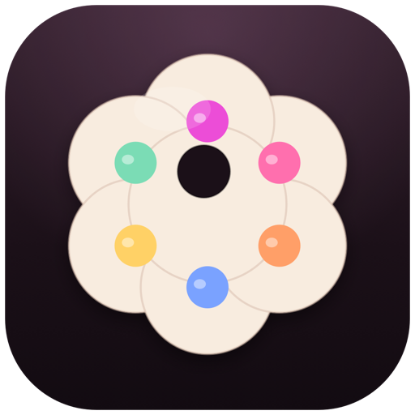

# Palette

<p align="center"></p>

A keyboard-first launcher for macOS, built as a native app with a deliberately
extensible provider system. Press a hotkey, type, act. No window chrome, no
Dock icon, no script layer holding the core together.

```
⌥Space → /edit dotfiles → ⏎ opens the folder in your editor
```

## Status

v2.18.0. Built for macOS 14+ (developed on macOS 27), Apple silicon. Not sandboxed
and not distributed through the App Store, by design: a launcher needs to see
your files and drive other apps.

## Feature timeline

Where each headline feature landed. Every fix, and everything before 1.8, is in
[CHANGELOG.md](CHANGELOG.md); the full list of providers and triggers is in
[PROVIDERS.md](PROVIDERS.md).

| Feature | Version |
|---|---|
| Pinned screenshots, on-device OCR, learned ranking, provider groups, 19-pane Settings, update nudge | 2.18.0 |
| Custom hotkey binder — `[[binding]]` launches an app, runs a shell command, opens a provider trigger, or opens a URL | 2.16.0 |
| Ask web search on by default; installed-font dropdowns; onboarding shows the real capture keys and Skip applies Essentials | 2.16.0 |
| Ask chat window — multi-turn, streaming, saved chats, markdown (code, tables, images), optional web search | 2.15.0 |
| NVIDIA NIM endpoint — 16 free chat models beside OpenCode Go | 2.15.0 |
| GitHub providers — `ghr` repositories, `ghp` pull requests, `ghi` issues, `gha` Actions runs, `ghn` notifications | 2.15.0 |
| Provider rail — full-height list of every provider, replacing the chip strip | 2.15.0 |
| Settings rebuilt — 7 panes, auto-apply, ⌘F search, scoped resets | 2.15.0 |
| Theme contrast enforced — accent, selection, badge and muted pairs measured | 2.15.0 |
| `/proj` can clone a repository and create a new project | 2.15.0 |
| `/gh` works outside a git repository | 2.15.0 |
| Ask answer window (single question, single answer) | 2.14.0 |
| Web app shortcuts registered by Palette, in-app | 2.14.0 |
| Ask model list mirrors the live endpoint (31 models) | 2.14.0 |
| Answer sound, Dock bounce and dock badge; ⌘Q dismisses instead of quitting | 2.14.0 |
| Atlas — fuzzy `/atlas <query>` search, review badge clears on ack | 2.14.0 |
| Default search allowlist — the `Plain queries` column in Settings → Providers | 2.13.0 |
| `app_mode` for `!` bangs — open a search in a web app | 2.13.0 |
| Ask reliability — 120 s timeout, empty replies fall back to the next model | 2.13.0 – 2.13.1 |
| Atlas provider over the local index | 2.12.0 |
| Adaptive preview layout (`preview_layout = "auto"`) | 2.12.0 |
| Providers table in Settings | 2.12.0 |
| Cheatsheets provider (`/cheat`) | 2.11.0 |
| `/ssh` inside the embedded terminal | 2.11.0 |
| `/shots` paste image action | 2.11.0 |
| Universal default search across chosen providers | 2.10.0 |
| End-to-end harness — `PALETTE_SCRIPT` with `dump=` and `assert=` | 2.10.0 |
| Siri Silver and Siri Graphite themes, Liquid Glass surfaces | 2.9.0 |
| Settings tabs with search, tiered search ranking | 2.8.0 |
| Bookmarks, `!` bangs, microphone picker | 2.7.0 |
| Annotator pointer tool | 2.6.0 |
| Universal capture shortcuts and the annotate window | 2.4.0 |
| Editor-agnostic paths, two-step onboarding | 2.3.0 |
| `/awake` with timers and clamshell mode | 2.2.0 |
| Scratchpad, embedded terminal, first-run setup | 2.0.0 |
| Clipboard transforms, typography overrides, `/port` | 1.9.0 |
| One-shot `/ask` answers and `/askh` history (later replaced by the chat window) | 1.8.0 |

## Requirements

| Tool | Why | Install |
|---|---|---|
| `fd` | filesystem enumeration for `/edit` and `/editf` | `brew install fd` |
| `fzf` | ranking for path results | `brew install fzf` |
| `zellij` | `/zj` sessions | `brew install zellij` |
| `kitty` | terminal used by `/zj` | `brew install --cask kitty` |
| `bw` | Bitwarden provider | `brew install bitwarden-cli` |
| `gh` | `/gh`, `/ghr`, `/ghp`, `/ghi`, `/gha`, `/ghn` | `brew install gh` |

Only `fd` and `fzf` are needed for the core file workflows. Missing tools are
surfaced as an install row inside the launcher; nothing is installed silently.

## Build and install

```sh
make            # build a release app bundle at build/Palette.app
make install    # copy it to ~/Applications
make run        # build and launch the bundle in build/
make test       # run the test suite
```

The app is ad-hoc signed. macOS may ask for Accessibility permission again
after a rebuild; that is expected without a Developer ID certificate.

### Homebrew

Palette ships through a public tap. Homebrew treats third-party taps as
untrusted, so the first install may ask you to approve it:

```sh
brew trust --tap Myleshen/tap
brew install --cask Myleshen/tap/palette
```

The cask downloads the latest GitHub release, installs `Palette.app` into
`/Applications`, and clears the quarantine flag because the app is ad-hoc signed
rather than notarized. No Apple Developer subscription or App Store listing is
involved. Manual zip downloads may need System Settings > Privacy & Security >
Open Anyway.

Palette asks GitHub once a day whether a newer release exists. When there is
one, the menu bar offers **Palette <version> available — Update…**, which runs
`brew update && brew upgrade --cask palette` in the embedded terminal; Palette
never installs anything itself. Turn the check off in Settings → General →
**Updates** (or `[updates] automatic = false`).

To publish a new version: bump `CFBundleShortVersionString` and
`CFBundleVersion` in `Resources/Info.plist`, add a `CHANGELOG.md` entry, merge
the PR, then push a `v<version>` tag. Tagging is the release: CI runs the tests,
builds the zip, publishes it with the CHANGELOG entry as the notes, and updates
the cask in `Myleshen/homebrew-tap`. See `CONTRIBUTING.md` and
`packaging/homebrew/README.md`.

### Release integrity

Releases are published as a draft first, carry GitHub build provenance, and
include a `SHA256SUMS` asset; a post-release job downloads them back and checks
the checksum and signature. To verify a download yourself, grab the zip and
`SHA256SUMS` from the release page, then run:

```sh
gh attestation verify Palette-<version>.zip --repo Myleshen/palette
shasum -a 256 -c SHA256SUMS
```

## Uninstall

A plain uninstall removes the app and its login item. Palette's data lives
outside the bundle, like most Mac apps, so ask Homebrew to zap it too when you
want a clean slate:

```sh
brew uninstall --cask --zap palette
```

That removes `~/.config/palette` (settings, providers, themes),
`~/.local/state/palette` (clipboard history, database, logs),
`~/Library/Caches/Palette` (Bitwarden session, favicons, web-app icons), the
preferences plist and saved window state.

macOS keeps the privacy grants separately from the app, so finish the reset with:

```sh
tccutil reset Accessibility dev.myleshen.palette
tccutil reset ScreenCapture dev.myleshen.palette
```

`tccutil` is the only way to clear them; Homebrew casks cannot run commands on
uninstall. If it reports `No such bundle identifier`, the grants are already
gone. Dragging the app to the Trash removes neither the data nor the grants.

## First run

1. Launch Palette. It lives in the menu bar.
2. Press `⌥Space`.
3. Run a command that pastes (for example a clipboard entry and `⌘⏎`) and grant
   Accessibility when prompted. Copy-only actions work without it.

On first launch, onboarding shows the launcher and clipboard shortcuts and the
four capture keys Palette will take: `⌘⇧3` full screen, `⌘⇧4` region, `⌘⇧6`
window, and `⌘⇧5` recording. These replace macOS's own screenshot shortcuts
while Palette runs. Step 2 picks a starting provider set — Essentials,
Developer, or Everything. **Skip setup** applies Essentials as well, so
declining setup never leaves every provider in the rail.

Configuration lives in `~/.config/palette`:

```
~/.config/palette/
  config.toml
  bookmarks.toml            # /bookmark entries, seeded with an example
  providers/
    neof/provider.toml      # user copy of the file provider, seeded for you
  themes/                   # optional user themes
```

The bundled `/edit` provider lives inside the app. On first run Palette writes a
commented `config.toml` and seeds `providers/neof` so both examples are ready to
use without copying anything.

State (history, clipboard, frecency) lives in `~/.local/state/palette`.
Caches live in `~/Library/Caches/Palette`.

## Using it

| Key | Action |
|---|---|
| `⌥Space` | show / hide |
| `⌥V` | clipboard browser with live preview |
| `⌘⌥T` | embedded terminal |
| `⌘⌥S` | scratchpad list |
| `⌘⌥A` | Ask |
| `↑` `↓` | move selection (or the focused rail/strip row) |
| `⏎` | primary action |
| `⌘⏎` | secondary action (usually paste, or reveal for paths) |
| `⌘K` | action list for the selection |
| `⌘1`…`⌘9` | open the nth result |
| `Tab` / `⇧Tab` | move focus search → list → rail → group strip; never changes the provider |
| `Esc` | leave the rail/strip/list, then clear the query, then dismiss |
| `⌘,` | open Settings |
| `⌘R` | reload config, themes, and providers after manual file edits |

Application rows expose Open, Show in Finder, Copy Bundle ID, and Copy Path in
`⌘K`; files and folders expose their own open/reveal/copy actions.

### Provider rail

A full-height rail sits on the left of the search field and cards. **Everything**
is pinned at the top and is the plain-query scope; **Apps** opens the app list.
Below them is one row per provider group and one per ungrouped provider. A group
(Bitwarden, GitHub) opens its first member and shows a secondary strip of its
children above the list; the strip also appears in the top-bar layout. Clicking a
row opens that provider with an empty query. The rail is always 220 pt wide and
never collapses; it scrolls a whole row at a time instead. Prefixes work with or
without the rail.

The launcher has four focus zones: **search**, **list**, **rail**, and the group
**strip**. `Tab` walks search → list → rail → strip and wraps; `⇧Tab` reverses.
`Tab` never switches the provider — use the rail, the strip, `⌘1`…`⌘9`, or a
prefix for that. Arrow keys move the list selection, the rail row, or the group
child depending on the focused zone; `⏎` acts on the list selection unless the
rail or strip is focused, where it confirms the provider and moves to the list.
`Esc` returns to search first, then clears the query, then dismisses. One focus
ring marks the active zone, and only the selected provider/chip is painted with
the accent.

### Prefixes

A prefix routes the query to one provider. The shared prefix character is
configurable (`provider_prefix`, default `/`), and each provider declares a bare
trigger word:

| Prefix | Provider |
|---|---|
| `/edit <query>` | files and folders, opened in the configured editor |
| `/editf <query>` | folders only, opened in the configured editor |
| `/zj <query>` | zellij sessions; `⏎` attaches or creates in kitty |
| `/bw <query>` | Bitwarden passwords |
| `/bwu <query>` | Bitwarden usernames |
| `/bwt <query>` | Bitwarden TOTP codes |
| `/bwn <query>` | Bitwarden notes |
| `/bwo <query>` | Bitwarden URLs |
| `/clip <query>` | clipboard history, text/images/files |
| `/ocr <query>` | on-device text and QR/barcode reading of a clipboard image or screenshot |
| `/port <query>` | listening TCP ports, with process and PID |
| `/cmd <query>` | commands from `~/.config/palette/commands.toml` |
| `/proj <query>` | devx projects and worktrees; clone a repository, create a project |
| `/git <query>` | repositories with managed Git actions and panel output |
| `/term` | embedded terminal shell |
| `/scratch` | scratch notes and the editor |
| `/awake` | keep the Mac awake; timed or clamshell mode |
| `/recent` | recently used projects and files |
| `/snip <query>` | snippets with placeholder expansion |
| `/web <query>` | saved web apps; type a domain to add one |
| `/bookmark <query>` | bookmarks from `bookmarks.toml`, opened as normal browser windows |
| `/emoji <query>` | emoji picker |
| `/sys <query>` | settings, lock, sleep, trash, reload, quit |
| `/theme <query>` | switch themes live |
| `/calc <expr>` | calculator (also works unprefixed) |
| `/timer <duration>` | countdown timer: `25m`, `1h30m`, `1:30`, or stop |
| `/shot` | screenshot the screen, a region, or a window |
| `/shots` | browse screenshots and recordings from the capture directory |
| `/cheat <query>` | cheatsheets (PDF, HTML, Markdown, text, images) from your configured folders |
| `/rec` | start or stop a screen recording |
| `/color` | pick a colour and copy its hex |
| `/win <query>` | switch to any open window |
| `/stats` | disk, memory, load, battery, uptime |
| `/ssh <query>` | hosts from `~/.ssh/config` |
| `/docker <query>` | containers: start, stop, restart, logs |
| `/gh <query>` | current repo, explicit `owner/repo`, or your open PRs |
| `/ghr <query>` | your repositories; open, clone, copy slug |
| `/ghp <query>` | pull requests you authored or that await your review |
| `/ghi <query>` | issues assigned to you |
| `/gha <query>` | workflow runs for the current repo or `owner/repo` |
| `/ghn <query>` | your GitHub notification inbox |
| `/atlas <query>` | atlas artifacts and docs, inbox first |

A trailing slash browses a directory breadth-first: `/edit ~/dev/` shows the
direct children of `~/dev` first, then the next level.

Unprefixed queries search apps (always) plus exactly the providers listed in
`[providers] global` (default `calc`, `search`, `web`, `win`, `zj`,
`bookmark`, `pins`, `system`, `timer`, `awake`, `cheat`). Settings → Providers →
**Plain queries** edits that allowlist, so you can add a provider or drop one — for
example remove `calc`. `/trigger` still targets one provider. `= 2+2` and bare
arithmetic also work while `calc` is on the list.

### Search matching

Matching is fzf-style, not exact-substring. Type the letters you remember and
Palette scores runs, word boundaries, and gaps: `actmon` finds **Activity
Monitor**, `vsc` finds **Visual Studio Code**, `qbf` finds **The quick brown
fox**, `tst` finds a Bitwarden login named **Test**, and `drgn` finds **Dragon**.
This applies to apps, clipboard text and file names, web apps, providers,
themes, and Bitwarden vault fields. Clipboard search scans the whole configured
history instead of only doing a SQL prefix match, so non-contiguous searches
work there too. `/edit` still delegates path ranking to the real `fzf` binary
with `--scheme=path`.

Ranking also learns: when a short plain query reliably leads you to one row,
that row is boosted as a tie-breaker on later queries (never over a clearly
better text match), so `chr` can open the Chrome you actually choose. The query
is stored only as a hash, and Settings → Search → **Learning** has the toggle
and a **Forget** button.

The empty-query screen is deliberately the **app list**: apps in alphabetical
order (or most-used), with pinned apps and pinned web apps at the top. Unpinned
web apps, running sessions, and search suggestions stay out of that screen until
you type or pick their tab.

### Web search

Type any query that is not a file or app and Palette offers one row per
configured engine (Google, DuckDuckGo, GitHub, YouTube by default). `⏎` opens
the result in your default browser. Engines are ordinary config rows in
`[web_search]`; add or remove them in Settings or `config.toml`.

Give an engine a keyword and `!keyword query` searches it directly, in its own
browser when one is set: `!gh palette launcher`. A bang opens a normal browser
window, unless the engine has **Open in web app** on, which sends that search to
the web-app browser (SSB) instead; that needs a Chromium-based web-app browser,
set per engine or under **Web apps**. Type `!` on its own to list every engine
that has a keyword. Settings → Search edits each engine as a row: Name ·
`!keyword` · Search URL · Browser · Open in web app.

### Ask

`⌘⌥A` opens the Ask chat window (also **Palette → Ask…**). The launcher has no
Ask tab and no `/ask` provider; the window is the only surface. Ask is chat
only: a multi-turn transcript where each turn sends the conversation so far,
with no tools, shell, or file access.

`⏎` sends and `⇧⏎` adds a line. Each turn sends the conversation to an
OpenAI-compatible endpoint. Answers stream in and render markdown (headings,
lists, tables, fenced code with a Copy button, links, and https images). Stop
cancels; closing the window or pressing `⌘⌥A` again does not — the answer keeps
streaming, is saved, and badges the Dock until you reopen the window. If Palette
is in the background when it completes you also get a Notification Center banner
and the answer sound (permission is requested the first time it posts).

Supported endpoints:

- **OpenCode Go** (`https://opencode.ai/inference/go/openai/v1`) — every
  OpenAI-compatible Go chat model, free models first, paid models cheapest
  output first. A Go key is required.
- **NVIDIA** (`https://integrate.api.nvidia.com/v1`) — a curated set of NIM
  chat models on the free tier, all marked `FREE`. An NVIDIA key is required.
  Keys come from `NVIDIA_API_KEY` or the encrypted local key file.

The model picker groups models by endpoint. Fallback only tries endpoints that
have a key: free models first, then the cheapest paid OpenCode Go models.

Chats are saved in Palette's SQLite database, not `config.toml`. The sidebar
lists them newest first with the title (first question, cut at about 48
characters), model, and age; a search field appears once there are more than
five. Opening a chat restores the transcript, sources, and
model, with the composer ready for another turn. New chat is `⌘N`; delete a chat
from its hover button or context menu (with confirmation). The legacy
`ask_history` table is still written, but the window's saved chats are the
history surface.

The composer's globe enables one web lookup for the turn (default in
**Settings → Ask → Search the web once per turn**, on by default). Turning the
globe off skips the search for that turn; a message that contains an `https://`
link still fetches that page. A
search runs once on DuckDuckGo HTML, reads up to four result pages in parallel,
and sends the text to the model as an untrusted source note. The answer shows a
numbered **Sources** list (click opens the browser), and the sources are saved
with the chat. If search or a page fetch fails, the answer continues and shows
`Search unavailable`.

API keys are stored in an encrypted user-only file under Palette's config
directory, not in `config.toml`. A key is visible in the Settings field only
before you save it; afterward Palette shows that a key exists and never displays
the value again. Keys are never written to `config.toml`, logs, or history.
`OPENCODE_GO_API_KEY` and `NVIDIA_API_KEY` are also accepted as environment
fallbacks.

### Settings

`⌘,` (or the menu-bar icon) opens a native Settings window with nineteen panes in
four sidebar groups. Basics holds **General**, **Launcher**, **Appearance**,
and **Shortcuts**; Features holds **Search**, **Ask**, **Embedded Terminal**,
**Bookmarks**, **Cheatsheets**, **Web Apps**, **Screenshots**, **After a
capture**, **Recordings**, and **Captures**; System holds **About** and
**Providers**; Advanced holds **Provider Files**, **Config Files**, and
**Diagnostics**. General holds startup, permissions, power, notifications, the
editor/terminal apps used by providers, clipboard history, and the command
prefix; Launcher holds where the panel opens, the search placeholder, app order,
and the panel size; Appearance holds themes, typography, and glass; Shortcuts
holds every global shortcut, including capture, recording, and your own **Custom
hotkeys**. **Search** holds the web-results toggle and one card per engine
(Name · Search URL · `!keyword` · Browser · Open in web app). **Ask** selects the
endpoint and model, saves a local API key, toggles fallback, answer
notifications (sound, Notification Center banner, Dock badge) and the per-turn
web search, and controls how many Q&A rows and how many days of history are
kept. **Providers** is one table with a row per provider — enable, the **Plain
queries** checkbox, name, trigger, aliases, and order in the same row. The
Advanced panes open the provider and config files, export a backup, and list
startup diagnostics, separate from the provider table.
Hotkeys are recorded by pressing them, not typed. The recorder uses a short-lived
session event tap, so macOS-reserved combinations such as `⌘Space` are captured
instead of being swallowed by the system; it stops as soon as Settings loses
focus. Accessibility permission is needed for reserved-key capture. Shortcuts
are checked as you set them: an invalid or duplicate value shows an inline error,
the footer counts it, and the file keeps the last valid value. A browser that is
not installed is not written. Changes apply immediately — there is no Save or Cancel;
the footer reports **Saved** or the failure, and **Reset `<pane>`…** restores that
pane's defaults. `⌘F` searches panes and sections. Editing files by hand still
works, then press `⌘R`.

### Custom hotkeys

The built-in shortcuts stay as they are; a `[[binding]]` row adds a general
binder that maps one global key to an app, a shell command, a provider trigger,
or a URL. Add rows in Settings → **Shortcuts → Custom hotkeys**, or write them
directly. An array of tables means keys with `+` need no quoting:

```toml
[[binding]]
keys = "ctrl+alt+g"
action = "launch"      # launch | command | provider | url
value = "Ghostty"
```

- `launch` opens an app by name, a path, or a URL.
- `command` runs the value in `/bin/zsh -lc` with no terminal window; failures
  are written to the app log.
- `provider` opens the panel with that trigger, e.g. `value = "calc"`.
- `url` opens the address in your default browser.

Bindings use their own key range and do not replace the launcher, capture, or
web-app shortcuts. An invalid key, a repeated key, or one already taken by a
built-in shortcut shows an inline error in Settings, is skipped at runtime with
a log warning, and never takes the app down.

### Search position

`search_position = "top" | "center"` controls where the panel opens. `center`
keeps the top-first layout but opens the panel in the middle of the screen.
The older `bottom` value is accepted for compatibility and now maps to
`center`.

The launcher is always the same pill layout: a floating search capsule above a
provider rail and a content card. There is no alternate classic layout.

### Preview layout

`preview_layout = "auto"` is the default: the preview sits beside the list when
the fixed frame is wide enough and below it on portrait frames.
`beside` and `below` remain explicit overrides. The pane takes room from the
list card; it never resizes the window. The launcher opens at one fixed frame
per display — 60% of each screen axis, or the absolute caps when those are
smaller — and does not grow or shrink with result count, preview, provider bar
or mode. The embedded terminal opens at 90% of that width and 85% of its
height, centred; the scratchpad keeps the full launcher frame.

### Pinned items

`⌘K` on any result includes **Pin to Palette**; every pinned row also offers
**Unpin from Palette**. Pinned apps and pinned web apps rise to the top of the
default app screen and global search. Pins are stored in Palette’s SQLite state.

### Clipboard

`⌥V` opens a wide clipboard browser with a live preview pane; `/clip` opens the
same history in the normal window. Copied text, images, and Finder file
selections share one list, newest first, and typing is ordinary search text.

- `⏎` on any clipboard row **pastes immediately** into the app you came from,
  after which the clipboard browser closes. With Accessibility granted this is
  a real ⌘V; otherwise Palette copies the entry and opens the permission prompt.
- Text rows preview in full; long entries can be copied in full or pasted.
- Images store a thumbnail and dimensions, with Copy/Paste Image.
- Files keep their paths, icon, size, and a `bat` render for text files, with
  Copy/Paste Files and Reveal in Finder.

Pinned entries keep their badge and rank higher in search, while the list
itself stays chronological. `⌘K` toggles **Pin** and **Delete** for every kind. Retention defaults to 5,000
entries and is configurable in Settings; images are stored as PNG and files as
paths in Palette’s SQLite state. Anything marked concealed by another app is
never recorded.

Values copied from Bitwarden are always written as concealed and clear after 30
seconds, so they never enter Palette’s clipboard history.

The vault listing and the CLI session key are sealed with AES-GCM under
`~/Library/Caches/Palette/Bitwarden` for thirty days, scoped to the active CLI
profile. Restarting Palette inside that window does not ask for the master
password again; **Refresh Bitwarden Cache** forces a fresh read without logging
you out. The master password itself is never stored.

### Screenshots and recordings

`/shot` captures the screen, a region, or a window; `/rec` starts and stops a
recording. Both use the system capture engine and land in the configured
capture directory. `⌘⇧3`, `⌘⇧4` and `⌘⇧6` capture the screen, a region and a
window from anywhere (they replace the macOS keys), `⌘⇧5` records, and a
menu-bar **Stop recording · m:ss** item shows while a recording runs. All four
live in Settings → **Shortcuts** and can be cleared or rebound.

A capture plays a shutter sound and shows a thumbnail for a couple of seconds
(both toggles in Settings → **Screenshots**), so it is obvious that it worked. `/shots`
lists everything in the capture directory, newest first and grouped by day —
screenshots and recordings together — with a thumbnail (a poster frame for
videos) on every row and in the preview pane, plus open, annotate, copy image,
paste image and reveal. **Paste image** puts the selected screenshot on the
pasteboard and pastes it into the app you came from. Thumbnails are generated
once per file and cached by path and modification date, so the rows reuse the
same cache as the preview.

Recordings can target the whole screen, a single display, or a fixed region, and
optionally include audio from the system default input or a chosen microphone
(`[capture] recording_microphone`), set under Settings → **Recordings**. Every
start — the hotkey, `/rec` and the menu — asks first in a compact options panel
(audio, microphone, display, area) that remembers the last choice, so the
recording never includes the panel that asked.
`[capture] gallery = "all" | "palette"` decides whether `/shots` lists everything
in the folder or only Palette's own `shot-*` and `rec-*` files.

The status menu has a capture section — **Start**, **Stop** with elapsed time,
**Copy Last Path**, **Reveal Last Capture**, **Show Last Recording** and **Show
Last Screenshot** — and every capture action reports the same way: in the panel
when it is open, otherwise a Notification Center banner plus a brief menu-bar
flash.

**Pins** float a screenshot above every other app and pass clicks straight
through, so it never gets in the way; hold `⌥` to show the grip and drag, resize
or scroll to zoom. Pin from the annotator (`⇧⌘P`), from a `/shots` row, or from
the menu bar, and up to 8 pins cascade down the screen (the oldest closes).

Images are read on device: clipboard images, the last screenshot, pins and the
annotator offer **Copy Text** (Vision OCR) and **Open Detected Link** from QR,
EAN and Code128 codes; `/ocr` lists the text found in the clipboard image or a
given path. Nothing leaves the Mac.

**Annotate** rows in `/shot` open the editor on the capture: pointer, arrow,
rectangle, text and crop, six colours, `⌘Z` undo, `⌘C` copy, `⌘S` save over the
original and `⌘⇧S` save as a copy. The pointer is the default tool: click a mark
to select it (dashed outline), drag to move it, press `delete` to remove it.
Text is typed in place — pick the text tool, click, type, press return — with a
size stepper for new text. `⌘+`, `⌘-` and `⌘0` zoom the canvas, which scrolls
while zoomed. Marks are stored as fractions of the image, so they look the same
at any window size, and cropping remaps them instead of dropping them.

Recordings open in a player window when they stop: play, scrub, reveal in
Finder, or copy the path. The preview keeps its size and position and no longer
hides when you switch apps. Both behaviours are toggles in Settings →
**Screenshots** (`edit_after_capture`, `preview_recording`), and the first
capture asks for Screen Recording permission once per build.

### Cheatsheets

`/cheat` lists PDF, HTML, Markdown, text and image files from the folders you add
in Settings → **Cheatsheets**, one level deep. Selecting a row previews it with
QuickLook inside the launcher; `⌥P` enlarges the preview. Rows also open the file
and reveal it in Finder. Folders and extensions are ordinary config:

```toml
[cheatsheets]
folders = ["~/Documents/cheatsheets", "~/dev/handbook"]
extensions = ["pdf", "html", "htm", "md", "markdown", "txt", "png", "jpg", "jpeg"]
```

### Atlas

`/atlas` lists what `atlas` has indexed in `~/.config/atlas/state.json`:
artifacts and docs, each shown as `project · path`. Inbox items sort first and
carry a **review** badge. `⏎` opens a row, Markdown and HTML rows preview in the
pane, and **Mark Reviewed** in `⌘K` runs `atlas review <path>`. The provider
only reads atlas's data and derives the marker, modification time and preview
path the same way atlas does, so atlas itself needs no change. Tick **Plain queries**
in Settings → Providers to let it answer unprefixed queries too.

### Bitwarden

`/bw`, `/bwu`, `/bwt`, `/bwn`, and `/bwo` share one in-memory session. The first
read of a vault is cached for **thirty days** in an AES-GCM encrypted file under
`~/Library/Caches/Palette/Bitwarden`; the key is a per-user `0600` file. Prefix
switches, typing, and copy actions reuse the snapshot instead of spawning
`bw list` again. Choose **Refresh Bitwarden Cache** in the menu-bar menu when the
vault changed elsewhere; the next search reads it fresh. The cache is scoped to
`BITWARDENCLI_APPDATA_DIR`, so test and real profiles never mix.

### Web apps

`/web` keeps your own web-app shortcuts, independent of any browser-specific
“install as app” feature. An **Add Web App…** row is always present; choose it
(and paste a URL), or type a domain directly:

1. `/web figma.com`
2. choose **Add Web App “Figma”**
3. give it a name, then optionally a shortcut such as `ctrl+alt+f`

Local development URLs work too: `/web http://localhost:5173` or
`/web http://127.0.0.1:8080`.

Web apps open in Helium by default, in their own Chromium **app window**
(`--app=…`) with a dedicated Palette profile, not as a normal browser tab.
Change the browser in Settings → Search; only Chromium-based browsers are
listed and Palette will not save one that is not installed.

A shortcut needs at least two modifiers. Palette registers it itself, so the
same app-window launcher opens the URL. Use `⌘K` on a saved app to open it,
copy its URL, set/change or clear its shortcut, or remove it. Opens are counted
by the normal frecency store, so frequently used apps rise to the top.
Definitions live in Palette’s SQLite state, not in `config.toml`.

### Bookmarks

`/bookmark` lists entries from `~/.config/palette/bookmarks.toml`, which is
seeded with a commented example on first run:

```toml
[[bookmark]]
name = "GitHub"
url = "https://github.com"
browser = "Safari"          # empty = system default browser
keywords = ["code", "repos"]
```

A bookmark opens the URL as a **normal browser window**, not the `/web` app
mode, and in the browser you pick. Edit rows in Settings → **Bookmarks**;
they are written back to the file as you edit.

### Clipboard transforms

`⌘K` on any text entry includes **Transform Text…**. Pick a transform and the
result opens with a full preview; `⏎` copies it and `⌘⏎` pastes it. Built-ins:
trim, JSON pretty/minify, YAML format, TOML format, Base64 encode/decode, URL
encode/decode, shell quote, path quote, uppercase/lowercase, sort/dedupe lines,
strip ANSI, Markdown link, and slug. Transforms are local and deterministic; no user script runs from a
clipboard copy.

### Scratchpad and terminal

`/scratch` lists saved notes and opens a persistent editor with a title field.
It accepts pasted text, supports normal selection and editing, and provides
**Paste**, **Copy All**, **Clear**, and **Save & Close**. Clipboard text entries
also have **Open in Scratchpad** in `⌘K`. The `⌘⌥S` shortcut opens this note list
(not the editor), with **New Scratch Note** first; picking a note opens the
editor, and `Esc` clears the list query and then dismisses as usual.

`/term` opens a persistent multiplexer session in the content panel using
SwiftTerm. By default it attaches Zellij's **Palette** session, then falls back
to tmux, then a plain shell. Closing the panel detaches the client; the session
and any long-running command keep running, and the next `/term` reattaches.
`⌘W` closes the panel. `/cmd` items also expose **Run in Panel**, which runs the
command in that same shell.

`/ssh <query>` lists hosts from `~/.ssh/config`; `⏎` runs `ssh <alias>` in the
embedded terminal, one session per host, so re-running the same host reattaches
to the existing connection. **Open in the external terminal** stays available as
the secondary action.

`[terminal_session]` controls this:

```toml
[terminal_session]
multiplexer = "auto"   # auto | zellij | tmux | none
name = "Palette"
shell = ""             # empty = fish if installed, else zsh
font = ""              # empty = kitty font, then theme mono
font_size = 0          # 0 = kitty size, then 13
```

The embedded terminal auto-detects Kitty's `font_family` and `font_size`.
Set a Nerd Font here (or install the one Kitty uses) so Zellij/fish icons render
correctly.

Palette sets `SHELL` to the chosen shell when it starts the multiplexer, so new
Zellij or tmux panes use fish too. An existing Zellij/tmux server keeps its old
environment; restart that session once after changing the shell.

### Developer commands

`/cmd` reads `~/.config/palette/commands.toml`. Each `[[command]]` declares a
title, keywords, executable, arguments, optional working directory, terminal or
GUI mode, and whether to ask for confirmation. Nothing is an inline shell string
in `config.toml`.

```toml
[[command]]
title = "Go Test"
keywords = ["go", "test"]
executable = "go"
args = ["test", "./..."]
cwd = "~/dev/project"
terminal = true
confirm = false
```

### Scratch notes, recent items, and snippets

`/scratch` lists named scratch notes plus **New Scratch Note**. Each note has a
title and body; edits are saved when you close the editor. Use `⌘⌥S` to open the
most recent note directly. `/recent` lists projects and files you have opened
through Palette, newest first.

`/snip` reads `~/.config/palette/snippets.toml`:

```toml
[[snippet]]
title = "Email signature"
keywords = ["mail"]
text = "Best,\nMyles\n{{date}}"
```

Snippets are never executed. `⌘K` copies the expanded text, copies the raw
template, or opens the expansion in the scratchpad. Supported placeholders:
`{{date}}`, `{{time}}`, `{{datetime}}`, `{{clipboard}}`, `{{uuid}}`,
`{{home}}`, and `{{user}}`.

### Keep awake

`/awake` (or the **Keep Awake** rail row) keeps the Mac awake for 15
minutes, 30 minutes, 1, 2, 4, or 8 hours, or until you stop it. It also has a
**Clamshell Mode (Lid Closed)** toggle and a menu-bar **Keep Awake** submenu.

Normal keep-awake runs `/usr/bin/caffeinate` as a detached child, so it needs
no password and keeps the Mac awake even after Palette quits. Timed sessions
expire on their own; an indefinite session lasts until you choose **Stop**.
Palette records the session in `keepawake.json` under its state directory and
restores the toggle and remaining time on the next launch. Clamshell mode is
different: macOS treats a lid close as forced sleep, so Palette arms a tiny
root guard through the standard administrator prompt. The guard keeps lid sleep
disabled while the flag exists, even after Palette quits. It disarms and exits
on battery power; launchd rechecks every 30 seconds and re-arms it when AC
returns. Turning clamshell off, or reaching the 12-hour safety cap, disarms it
for good. Never leave an awake, closed MacBook in a bag.

### Projects, ports, and Git

- `/proj` lists devx projects and worktrees when devx is installed, with Open in
  Neovide, Open Terminal, Open Workspace, New/Remove Worktree, and Apply Config.
  With an empty query it also offers **Clone a repository…** (`devx project
  clone` into a scan root) and **New project…** (create a directory, `git init`,
  and `devx project add`). Without devx it falls back to Git repositories
  directly under `~/dev`.
- `/port` lists listening TCP ports with process, PID, user, and working
  directory. Open `localhost:PORT`, copy the port/PID, or terminate with SIGTERM
  and explicitly force-kill with SIGKILL; both kills require confirmation.
- `/git` lists repositories and exposes status, branch, stage all, commit with a
  message, fast-forward-only pull, push, recent log, and LazyGit. Status, log,
  and mutations run as managed subprocesses and return their output to the
  panel; only **Open LazyGit** launches a terminal. Complex Git work still
  belongs in LazyGit; Palette never force-pushes or rewrites history.
- `/gh` shows the current checkout's PRs and issues, an explicit `owner/repo`,
  or your open PRs when there is no repository. `/ghr` lists your repositories
  with **Clone into …** through devx and **Copy slug**; `/ghp` separates PRs you
  authored from ones awaiting your review; `/ghi` lists issues assigned to you;
  `/gha` lists workflow runs with **View Log**, **Re-run Failed Jobs**, and
  **Cancel Run**; `/ghn` is the notification inbox with **Mark Done**. The
  family needs the `gh` CLI and `gh auth login`.

### App and file actions

Application rows offer **Open**, **Show in Finder**, **Copy Bundle ID**, **Copy
Path**, **Quit App**, and, for apps under `/Applications`, **Move App to the
Trash…** with a confirmation. Project, path, recent, command, port, Git, and
Finder-file rows include **Open in Embedded Terminal** at the row's directory.
Clipboard file previews use QuickLook, so PDFs, images, archives, and other
formats render directly in the preview pane.

### Typography

`[typography]` overrides the active theme. Empty strings and zero sizes inherit
from the theme, which in turn falls back to the system font. Settings →
Appearance has installed-font dropdowns for the UI and mono families, size
controls for UI, mono and preview text, a live preview, and **Reset to Theme**. **Inherit** is the empty
value. A configured family that is no longer installed stays selected and is
marked **(missing)** instead of being silently reset.

```toml
[typography]
ui_family = "Avenir Next"
mono_family = "Menlo"
ui_size = 15
mono_size = 13
preview_size = 13
```

### Provider aliases, order, and visibility

`[providers]` stores rail order, extra trigger words, the allowlist of providers
that answer plain queries, and providers you want to hide. Settings → Providers
is one table with a row per provider: enable it, tick **Plain queries** to
include it in plain search, see its trigger, edit aliases, and set order in the
same row.
The rail and Tab cycling only include enabled
providers. Aliases are added as words in that row; the canonical trigger never
changes. Duplicate aliases or triggers are rejected as you set them.

```toml
[providers]
order = ["apps", "clip", "port", "git", "proj"]
disabled = []
global = ["calc", "search", "web", "win", "zj",
          "bookmark", "pins", "system", "timer", "awake", "cheat"]

[providers.aliases]
apps = ["launch", "a"]
clip = ["cb"]
```

### Themes

`/theme` switches live. Built-ins include Default Dark/Light, Catppuccin
Mocha/Latte, Gruvbox Dark/Light, and **Aetheria Pink** (the pink/violet Noctalia
palette). Settings can choose the dark/light pair and auto/dark/light mode; theme
TOML files live in `~/.config/palette/themes`.

## Configuration

Minimal `config.toml`:

```toml
hotkey = "opt+space"
provider_prefix = "/"
terminal = "kitty"
terminal_app = "kitty"
editor_open_with = "neovide"
clipboard_hotkey = "opt+v"
terminal_hotkey = "cmd+option+t"     # empty disables
scratchpad_hotkey = "cmd+option+s"   # empty disables
ask_hotkey = "cmd+option+a"          # empty disables
screenshot_hotkey = "cmd+shift+3"
recording_hotkey = "cmd+shift+5"
search_position = "top"        # top | center
web_app_browser = "Helium"
app_sort = "alphabetical"      # alphabetical | frequent

# Global shortcut → action. Add one table per key.
[[binding]]
keys = "ctrl+alt+g"
action = "launch"              # launch | command | provider | url
value = "Ghostty"

[window]
preview_layout = "auto"        # auto | beside | below
provider_bar = "top"           # top | left | hidden
favicons = true                # fetch web-app site icons

[timer]
presets = [5, 10, 15, 25, 30, 45, 60]   # minutes, shown in /timer
sound = true                   # chime when a timer finishes
notify = true                  # system notification when a timer finishes

[typography]
ui_family = ""                 # empty inherits the theme
mono_family = ""
ui_size = 0
mono_size = 0
preview_size = 13               # 9…24; preview pane, snippets, Ask body

[providers]
order = ["apps", "clip", "port", "git", "proj"]
disabled = []
global = [
  "calc", "search", "web", "win", "zj",
  "bookmark", "pins", "system", "timer", "awake", "cheat",
]                              # plain queries search exactly these; apps always

[providers.aliases]
apps = ["launch"]

[terminal_session]
multiplexer = "auto"
name = "Palette"
shell = ""
font = ""
font_size = 0

[cheatsheets]
folders = []                   # /cheat lists these one level deep
extensions = ["pdf", "html", "htm", "md", "markdown", "txt", "png", "jpg", "jpeg"]

[web_search]
enabled = true

[[web_search.engines]]
name = "Google"
url = "https://www.google.com/search?q={query}"
keyword = "g"

[[web_search.engines]]
name = "DuckDuckGo"
url = "https://duckduckgo.com/?q={query}"
keyword = "ddg"

[[web_search.engines]]
name = "GitHub"
url = "https://github.com/search?q={query}"
keyword = "gh"

[[web_search.engines]]
name = "YouTube"
url = "https://www.youtube.com/results?search_query={query}"
keyword = "yt"
app_mode = true                # !yt opens in the web-app browser

[theme]
mode = "auto"                 # dark | light | auto
dark = "siri-graphite"
light = "siri-silver"

[scopes.projects]
roots = ["~/dev", "~/dot-files"]
exclude = ["**/node_modules/**", "**/.git/**", "**/.build/**", "**/target/**"]
include_hidden = false
max_depth = 12

[clipboard]
enabled = true
max_entries = 5000
poll_ms = 500
clear_after_ms = 30000
```

See [ARCHITECTURE.md](ARCHITECTURE.md) for the full model, [THEMING.md](THEMING.md)
for themes, and [PROVIDERS.md](PROVIDERS.md) for writing your own provider.

`terminal` is the binary `/zj` launches; `terminal_app` is the GUI terminal used
for Bitwarden login/install prompts. Both default to `kitty`; `Terminal` is also
supported.

## Extending

Two kinds of provider:

- **Paths providers** are declarative manifests backed by the built-in fd + fzf
  engine. `/editf` is the reference copy: duplicate it, change `kind` and
  `open_with`.
- **Command providers** are any executable that speaks newline-delimited JSON
  over stdin/stdout. Write one in shell, Python, Swift, or anything else. A
  complete Python example ships in `Resources/Examples/hello`.

```toml
# ~/.config/palette/providers/hello/provider.toml
id = "hello"
name = "Hello"
trigger = "hello"
command = ["./hello.sh"]
timeout_ms = 1000
```

A user provider with the same `id` as a bundled one overrides it. Provider
manifests are discovered from `~/.config/palette/providers`; Palette reloads
them automatically when a manifest changes, and `⌘R` forces a full reload.

## Development

```sh
swift build
swift test
make e2e           # end-to-end flows against build/Palette.app
make run
make debug-app     # build and launch Palette Debug.app
```

`make debug-app` builds `build/Palette Debug.app` with its own bundle id
(`dev.myleshen.palette.debug`) and its own config and state under
`~/Library/Application Support/Palette Debug`, then opens it through
LaunchServices. A debug run never reads or writes the installed app's files, and
permission prompts attribute to **Palette Debug** rather than the terminal that
started it. `make debug` is the same target.

Layout:

```
Sources/PaletteCore        models, config, theme, query, ranking, storage contracts
Sources/PalettePlatform    macOS services: hotkey, panel, clipboard, fd/fzf, launch
Sources/PaletteProviders   bundled providers
Sources/PaletteRuntime     provider manifests and the external-process runtime
Sources/PaletteApp         SwiftUI/AppKit shell
Tests/                     unit and conformance tests
```

## Troubleshooting

**Nothing happens on the hotkey.** Another app may own it. Change `hotkey` in
`config.toml`, or quit the conflicting app.

**`fd`/`fzf` not found.** GUI apps do not inherit your shell `PATH`. Palette
probes `/opt/homebrew/bin`, `/usr/local/bin`, and `~/.local/bin`; if your tools
live elsewhere, set `tools_path` in `config.toml`.

**Paste does nothing.** Grant Accessibility in System Settings → Privacy &
Security → Accessibility, then relaunch.

**File results are stale.** Palette re-walks on demand and caches briefly. Use
`⌘R` to force a refresh.

**A provider misbehaves.** Check `~/.local/state/palette/logs/palette.log` and
the provider's stderr in the same log.

## License

Palette is released under the [MIT License](LICENSE). © 2026 Myleshen.
